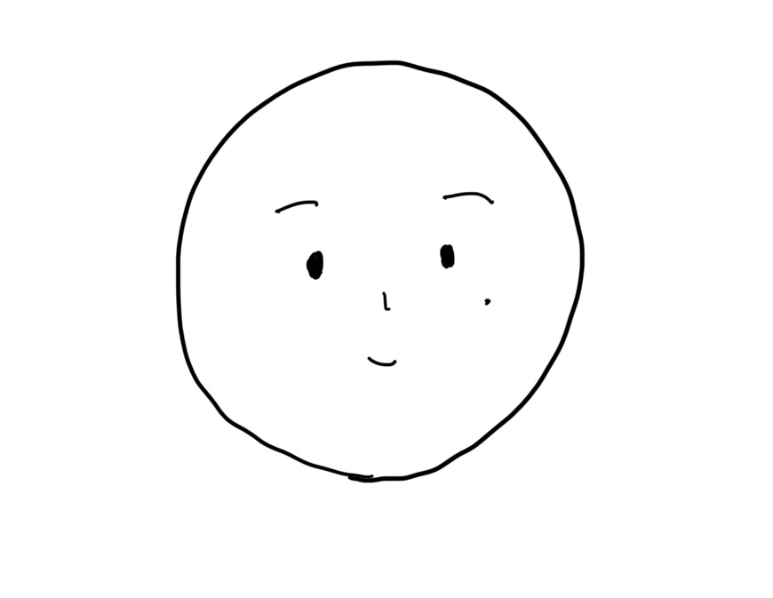
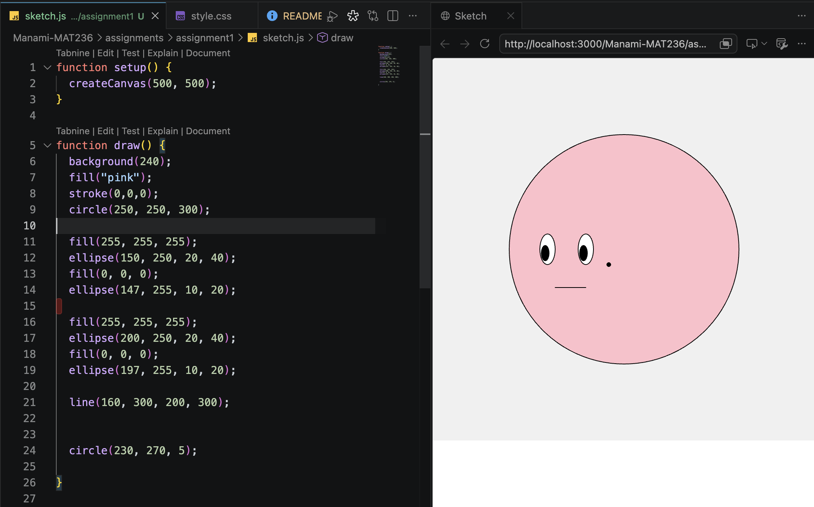

# Mini Assignment 1

A drawing made by hand and recreated in p5.js using basic shapes.

## Hand Drawing

## p5.js Drawing

## Run Locally

Open this folder in VS Code and serve `index.html` using Live Server. The sketch uses p5.js, with library files included in the `libraries` folder.
