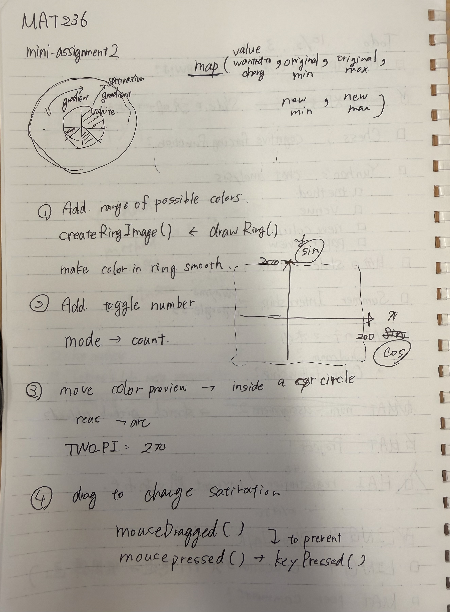

# Mini Assignment 2 — Color Wheel

A p5.js sketch for exploring color combinations through hue and saturation.

[Assignment instructions](https://csvad26.github.io/course_site/assignments/mini-assignment-2)

## Changes

1. **Expand the range of available colors.** Replaced `drawRing()` with `createRingImage()` to make the colors in the ring blend smoothly. Hue changes around the ring, while saturation increases from white at the inner edge to vivid colors at the outer edge.

2. **Toggle the number of selected colors.** Replaced the fixed color scheme modes with a `colorCount` variable. The space bar cycles through two, three, and four colors, evenly spaced around the color wheel.

3. **Move the color preview inside the circle.** Replaced the rectangular previews with pie-shaped sectors in the center of the ring using `arc()`. Each sector takes up `TWO_PI / colorCount` radians, so the selected colors share the preview equally.

4. **Drag to change saturation.** Added `mouseDragged()` to adjust saturation based on the distance from the center using `map()`, while the mouse angle controls hue. Moved the color count toggle from `mousePressed()` to `keyPressed()` so dragging does not also change the number of colors.

## Handwritten Notes

---

This README was organized and written up by AI based on the handwritten notes above.
