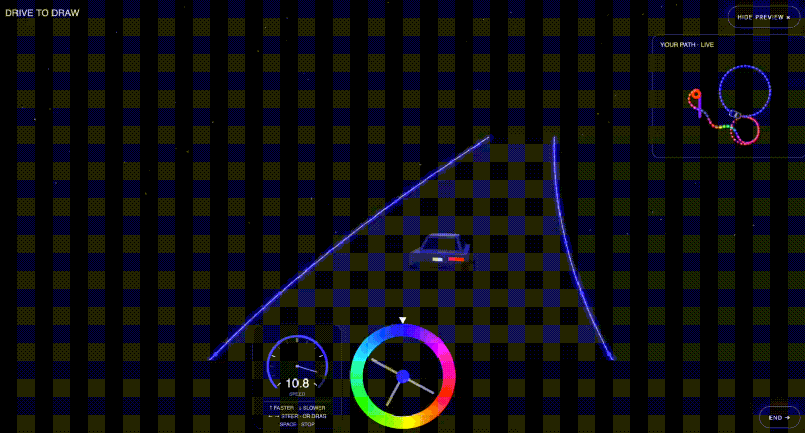
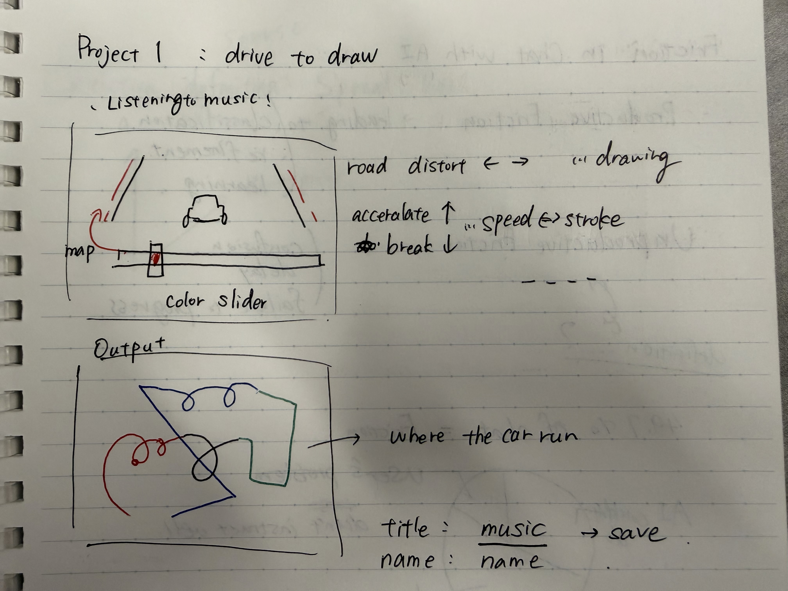
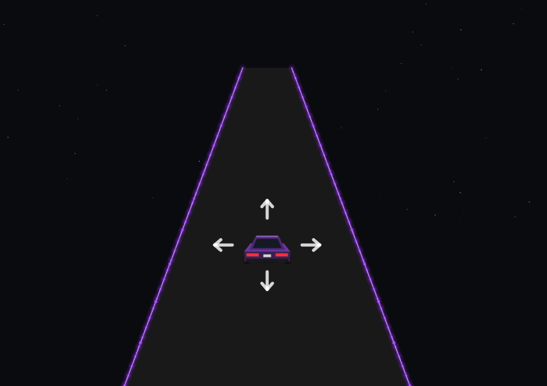

# Project 1: DRIVE TO DRAW

By Manami Nakagawa

When we draw, we usually look at a canvas from above, deciding where to place each color and line. In a way, we act like managers, controlling the drawing from the outside. But ***what if we could step inside the canvas and draw from the color's own point of view?*** DRIVE TO DRAW explores this idea through driving. Instead of placing strokes directly, you steer through the canvas, changing direction and speed while leaving a colorful trail behind. Without a fixed destination or a finished image in mind, the drawing gradually emerges from the journey itself.

## Idea

The idea for DRIVE TO DRAW started with [Mini Assignment 2](../MiniAssignment2/README.md), where I created a tool to select colors by moving the mouse around a color wheel. As I moved the mouse in circles, the motion reminded me of turning a steering wheel.

This made me think about how we usually draw. Most drawing tools let us look at the canvas from above, choosing colors and deciding where to place each line. In a way, we act like managers of colors and lines, controlling everything from the outside. But what if we could experience drawing from the color's own point of view?

I started imagining a drawing tool where the user could drive through a canvas, like going for a drive without a fixed destination. Instead of deciding exactly what to draw beforehand, the user could explore, change direction and speed, and discover an image along the way. The steering wheel would also serve as a color wheel, connecting the direction of movement with the color of the trail.

For the visual design, I drew inspiration from my experience of driving on a highway at night. I remember how the lane markings and lights seemed to glow against the darkness, making the road feel almost like a video game. I also felt as if I were part of those glowing lines, rather than simply observing them from the outside. I wanted to bring that feeling into drawing, where the user could move along with the line instead of controlling it from above.

This became DRIVE TO DRAW, a drawing tool that combines driving and color selection. The main interface focuses on the driving experience, while a small live preview shows the drawing from above. At the end of the drive, the user can step back and see the entire path as a finished artwork.

## Functionality

After a short countdown (READY?, 3, 2, 1, GO!), the car starts moving and leaves a colored trail behind. Users can steer using the left and right arrow keys or by rotating the steering wheel with the mouse. The up and down arrow keys control speed, while the spacebar pauses and resumes movement.

The steering wheel also works as a color wheel. A fixed pointer indicates the currently selected color, so turning the wheel changes both the car's direction and the color of its trail. Users can also pause the car to select a color without moving.

Speed affects not only how fast the car moves, but also how the drawing looks. At lower speeds, the trail forms a continuous line. At higher speeds, the marks become shorter and more spaced out, creating a dashed pattern. By accelerating and slowing down, users can change the rhythm and texture of their drawing.

A small live preview shows the drawing from above and can be hidden or revealed using the R key or the preview button. Pressing END reveals the full artwork, while START OVER clears the drawing and begins a new session.

## Controls

| Input | Action |
| --- | --- |
| Left / Right arrow keys | Turn the wheel to change steering and color. |
| Up / Down arrow keys | Increase or decrease the driving speed. |
| Drag the wheel's center sideways | Turn the wheel with the mouse. |
| Drag around the wheel's outer ring | Rotate the wheel with the mouse. |
| Space | Stop or resume movement while keeping the chosen speed. |
| R or the preview button | Hide or reveal the live drawing preview. |
| END | Finish the drive and display the artwork after the countdown. |
| START OVER | Clear the artwork and begin a new countdown. |

## Design Principles and Constraints

The main constraint is that the user draws through movement rather than placing marks wherever they want. The car keeps moving unless stopped, and its heading changes gradually. This encourages continuous lines, curves, loops, and crossings. There is no separate tool for placing an unrelated shape or starting a line somewhere else. The drawing records one connected journey, even when parts of its visible trail are dashed.

Another constraint is that color and steering share the same wheel. Choosing a new color can also change the direction of travel. This makes the two decisions depend on each other. It may be inconvenient when the user wants a very specific color and curve, but that tension is part of the tool's character. I want users to respond to unexpected marks instead of controlling every detail in advance.

These constraints encourage users to work with unexpected outcomes rather than plan every detail in advance. A turn made to change color might create an unexpected curve, while a change in speed alters the texture of the trail. I wanted these small surprises to become part of the creative process, rather than mistakes to correct.

The dark background and bright lines give the work a consistent neon appearance. The user chooses hue, while the tool sets the brightness, saturation, and line treatment. These limits help different drawings feel related without making them identical.

## Process and Iteration

### Exploring the Idea

Early on, I considered connecting the tool to the Spotify API so that the drawing could respond to music, such as its rhythm and other characteristics. However, I decided not to pursue this idea because of practical challenges with authentication and running the app locally. I wanted the tool to be easy to open and use, so I chose to focus on the driving interaction instead.

I also explored different ways of selecting colors, including sliders and other separate controls. However, using the steering wheel as a color wheel made the most sense within the driving experience. Rather than introducing another control, I wanted a single action to change both direction and color. This also reinforced the idea that the user is moving along with the color instead of managing it separately.

### Designing the Interaction

Initially, I imagined users controlling the steering wheel with the mouse, since mouse interaction feels natural for a drawing tool. However, I also wanted speed to affect the appearance of the trail, allowing users to create continuous or dashed lines by accelerating and slowing down.

The up and down arrow keys seemed like an intuitive way to control speed. However, this would require right-handed users to switch between the mouse or trackpad and the arrow keys. To make the interaction easier, I added steering controls to the left and right arrow keys as well, allowing users to control both direction and speed without switching between the mouse and keyboard.

### Making the Interaction Discoverable

Since users might instinctively reach for the mouse in a drawing tool, I wanted to encourage them to try the arrow keys without verbal instructions. I added four pulsing arrows around the car that disappear once an arrow key is pressed. I also adjusted the car's size and position to make room for these hints. The dashboard provides short keyboard instructions as additional guidance.

I also wanted users to recognize the driving experience before it began. Inspired by Mario Kart, I added a countdown (READY?, 3, 2, 1, GO!) to help users shift their expectations from drawing to driving, rather than suddenly starting the car.

## Reflections 

I'm not sure how practical DRIVE TO DRAW is as a conventional drawing tool. It doesn't offer precise control over colors or lines, and creating a specific image can be difficult. However, that is partly what I wanted to explore. Rather than making another tool for managing colors and shapes, I wanted to change the role of the creator from someone controlling a drawing from above to someone experiencing it from within. In that sense, I'm happy with how it turned out.

Looking at the finished drawings, I also found myself thinking about how the experience is a little like life. While driving, we make small decisions without knowing exactly where they will lead. Only afterward can we look back and see the path those decisions have created. I like that the resulting drawing captures not only what we intended, but also the unexpected turns along the way.

I hope people enjoy driving around, playing with colors, and seeing what they end up creating. Even if the drawing isn't what they expected, I hope they have fun along the way.
